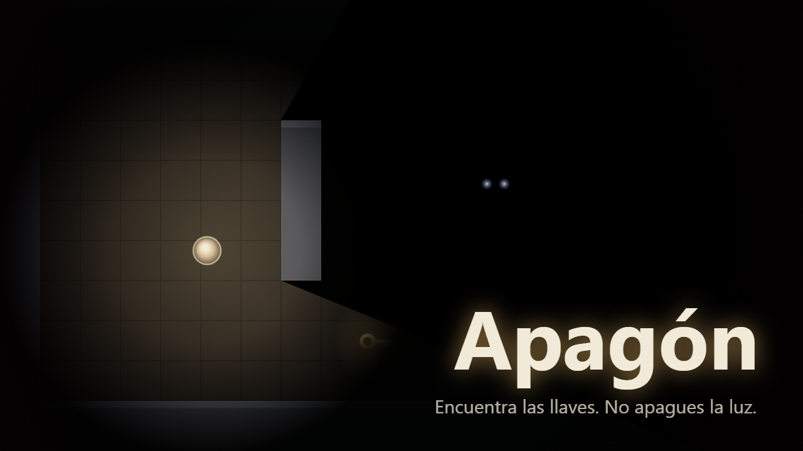

# Apagón

Estás atrapado en una casa a oscuras. Solo ves lo que alcanza tu linterna. Encuentra las llaves y sal antes de que algo te alcance.

**Jugar:** https://dannnyusssssss.github.io/Apagon/



## Cómo se juega

- La casa tiene tres habitaciones: entrada, salón y sótano. En cada una hay **una llave**; cambian de sitio en cada partida.
- Con las tres llaves, abre la **puerta de salida** del sótano.
- Algo te persigue en la oscuridad. **La luz lo detiene un rato**, pero se acostumbra a ella, y a oscuras es más rápido.
- La linterna **gasta batería**: el círculo de luz se estrecha al gastarse. Busca **pilas** para recargarla.

## Controles (solo teclado)

| Tecla | Acción |
|---|---|
| W A S D o flechas | Moverse |
| Shift o F | Encender o apagar la linterna |
| E | Recoger llaves y pilas, abrir la puerta |
| Esc o P | Pausa |
| M | Silenciar el sonido |
| Tab | Salir del juego (deja de capturar el teclado) |

Si Shift abre un aviso del sistema, usa F.

## Accesibilidad

- **Reducir parpadeo** (en el inicio y en la pausa): quita el parpadeo suave de la linterna y las animaciones del menú. Se activa solo si el sistema tiene activado "reducir movimiento". Aun sin activarlo, ningún cambio de luz supera 3 por segundo ni apaga la pantalla.
- **Jugable sin sonido:** la batería baja y la cercanía del enemigo también se muestran en pantalla.
- Se juega entero con teclado. El juego se pausa solo al perder el foco.

## Contenido

Oscuridad, tensión y persecución. Sin sangre ni imágenes explícitas. Incluye cambios suaves de luz (se pueden reducir). Edad orientativa: 12+.

## Privacidad

El juego no recoge datos personales ni se conecta a ningún servicio. Solo guarda en tu navegador los ajustes (reducir parpadeo, silencio) y tu mejor tiempo, con la clave `apagon:v1`.

## Desarrollo

Requisitos: Node 24 y npm.

```
npm ci            # instalar dependencias (solo de desarrollo)
npm run dev       # servidor de desarrollo
npm run test      # tests
npm run lint      # lint
npm run build     # comprobar tipos y generar dist/
npm run preview   # servir dist/
```

Hecho con Vite, TypeScript y Canvas 2D, sin motores ni dependencias en tiempo de ejecución. Todo el arte se dibuja con código y todo el sonido, música incluida, se sintetiza con WebAudio. Herramientas de desarrollo: ver [docs/DEBUG.md](docs/DEBUG.md).

## Despliegue

El workflow [`.github/workflows/deploy.yml`](.github/workflows/deploy.yml) corre lint, tests, auditoría y build en cada push a `main`, y publica `dist/` en GitHub Pages solo si todo pasa.

Una sola vez, en el repositorio: **Settings → Pages → Build and deployment → Source: GitHub Actions**.

## Licencia

Todos los derechos reservados. Titular: Danny Sivinta.

Detalle de licencias de las herramientas de desarrollo en [docs/LICENSES.md](docs/LICENSES.md).
