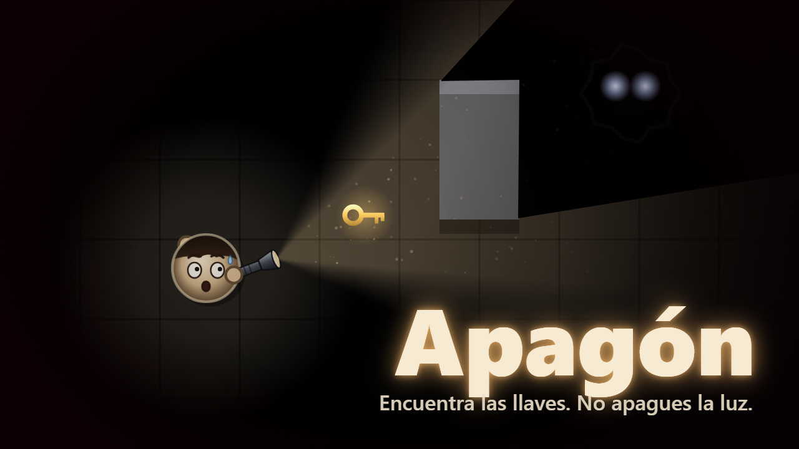

# Apagón

Estás atrapado a oscuras. Solo ves lo que alcanza tu linterna. Encuentra las llaves y sal antes de que algo te alcance.

**Jugar:** https://dannnyusssssss.github.io/Apagon/



## Cómo se juega

- Hay **tres niveles**, de menos a más difícil:
  1. **La casa:** entrada, salón y sótano.
  2. **El sótano profundo:** pasillos estrechos, menos pilas y menos batería, y lo que te persigue corre más.
  3. **El bosque:** de noche, entre árboles y rocas. Aquí son **dos** los que te persiguen.
- Cada nivel tiene tres zonas con **una llave** en cada una; cambian de sitio en cada partida. Con las tres llaves, abre la **salida**: una puerta o, en el bosque, una verja.
- **Continuar** retoma el nivel más alto que hayas alcanzado y **Nueva partida** empieza desde el primero. Se guarda tu mejor tiempo de cada nivel y el de la partida completa, que solo cuenta si juegas los tres seguidos desde "Nueva partida". Los intentos fallidos también suman tiempo.
- Algo te persigue en la oscuridad. La linterna alumbra **hacia el cursor del ratón**, hacia donde indiques con el segundo joystick en pantallas táctiles o, si no apuntas, hacia donde caminas: si le apuntas, **la luz lo detiene un rato**, pero se acostumbra a ella, y a oscuras es más rápido. Lo que llega por la espalda no se detiene.
- La linterna **gasta batería**: su alcance se estrecha al gastarse. Busca **pilas** para recargarla.

## Controles

Teclas por defecto. Todas, salvo Esc, F3 y Tab, se pueden cambiar en **Opciones → Controles**.

| Tecla | Acción |
|---|---|
| W A S D o flechas | Moverse |
| Ratón | Apuntar la linterna |
| Shift o F | Encender o apagar la linterna |
| E | Recoger llaves y pilas, abrir la salida |
| Esc o P | Pausa (Esc pausa siempre) |
| M | Silenciar el sonido |
| F3 | Mostrar u ocultar el rendimiento (FPS) |
| Tab | Salir del juego (deja de capturar el teclado) |

Si Shift abre un aviso del sistema, cambia la tecla en Opciones o usa F.

### En celular o tableta

| Control | Acción |
|---|---|
| Arrastrar en el lado sin botones | Moverse |
| Arrastrar en el lado de los botones | Apuntar la linterna (opcional) |
| Botón Linterna | Encender o apagar la linterna |
| Botón Interactuar | Recoger llaves y pilas, abrir la salida; muestra la acción disponible |
| Botón de pausa | Pausa |

Los controles aparecen solos al tocar la pantalla. Se juega mejor en horizontal, pero también funciona en vertical. Se puede mover y pulsar a la vez, y el teclado sigue funcionando en equipos con ambos.

## Menús y opciones

El inicio y la pausa solo tienen lo necesario para jugar, más **Cómo jugar** y **Opciones**. Opciones se abre como una ventana con cuatro pestañas (se cambian con las flechas, y Esc o "Volver" la cierran):

- **Accesibilidad:** reducir parpadeo y linterna clásica.
- **Sonido:** silencio y volumen de música, efectos y enemigo. Ningún ajuste puede subir el sonido por encima del volumen normal del juego.
- **Controles:** apuntar con el ratón, velocidad de giro de la luz (50 a 150 %), cambiar las teclas (con aviso si una ya está en uso y botón para restaurarlas) y, en dispositivos táctiles, los controles en pantalla.
- **Pantalla:** calidad gráfica (baja, media o alta: menos píxeles para equipos lentos), brillo (un poco más claro en pantallas oscuras, sin iluminar lo que la luz no alcanza) y el panel de rendimiento.

## Accesibilidad

- **Reducir parpadeo** (en el inicio y en Opciones): quita el parpadeo suave de la linterna y las animaciones del menú. Se activa solo si el sistema tiene activado "reducir movimiento". Aun sin activarlo, ningún cambio de luz supera 3 por segundo ni apaga la pantalla.
- **Jugable sin sonido:** la batería baja y la cercanía del enemigo también se muestran en pantalla.
- **Linterna clásica (más fácil)** (en Opciones): cambia el haz por un círculo de luz alrededor del personaje, que detiene al enemigo venga de donde venga. Se guarda en el navegador.
- **Apuntar con el ratón** (en Opciones): se puede desactivar. Sin ratón, el juego se completa solo con teclado.
- **Sonido posicional:** con auriculares se oye de qué lado y a qué distancia está el enemigo, y suena apagado si hay paredes de por medio. Cuando está cerca, el borde de la pantalla se oscurece más por el lado del que viene.
- **Teclas a tu gusto:** cada acción admite dos teclas y se pueden cambiar; la tabla se maneja con teclado o ratón.
- **Volumen por separado** de música, efectos y enemigo, y **brillo** para pantallas oscuras.
- **Controles táctiles** (en Opciones, en dispositivos táctiles): automático, siempre o nunca. **Controles a la izquierda (zurdos)** intercambia los lados. Ninguna acción exige un gesto de varios dedos.
- Se puede jugar entero con teclado o con los dedos. El juego se pausa solo al perder el foco.

## Contenido

Oscuridad, tensión y persecución. Sin sangre ni imágenes explícitas. Incluye cambios suaves de luz (se pueden reducir). Edad orientativa: 12+.

## Privacidad

El juego no recoge datos personales ni se conecta a ningún servicio. Solo guarda en tu navegador los ajustes (reducir parpadeo, silencio, volúmenes, linterna clásica, apuntar con el ratón, giro de la luz, teclas, controles táctiles y zurdos, calidad, brillo y panel de rendimiento), el nivel alcanzado y tus mejores tiempos, con la clave `apagon:v1`.

## Desarrollo

Requisitos: Node 24 y npm.

```
npm ci            # instalar dependencias (solo de desarrollo)
npm run dev       # servidor de desarrollo
npm run test      # tests
npm run lint      # lint
npm run build     # comprobar tipos y generar dist/
npm run preview   # servir dist/
```

Hecho con Vite, TypeScript y Canvas 2D, sin motores ni dependencias en tiempo de ejecución. Todo el arte se dibuja con código y todo el sonido, música incluida, se sintetiza con WebAudio. Cómo está hecho: ver [docs/ARCHITECTURE.md](docs/ARCHITECTURE.md). Herramientas de desarrollo: ver [docs/DEBUG.md](docs/DEBUG.md).

## Despliegue

El workflow [`.github/workflows/deploy.yml`](.github/workflows/deploy.yml) corre lint, tests, auditoría y build en cada push a `main`, y publica `dist/` en GitHub Pages solo si todo pasa.

Una sola vez, en el repositorio: **Settings → Pages → Build and deployment → Source: GitHub Actions**.

## Licencia

Todos los derechos reservados. Titular: Danny Sivinta.

Detalle de licencias de las herramientas de desarrollo en [docs/LICENSES.md](docs/LICENSES.md).
